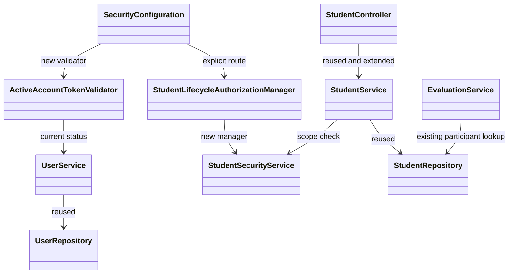
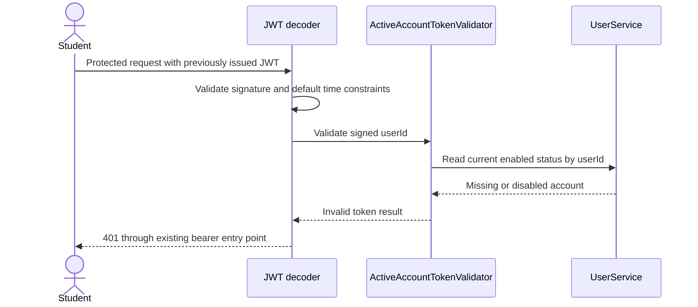

# Student lifecycle design

**Realizes:** [UC-STU-deactivate-student](../requirements/use-cases.md#uc-stu-deactivate-student-the-course-admininstructor-deactivates-a-student).
**Depends:** FR-SEC-authentication, FR-SEC-authorization, FR-SEC-deny-unauthorized, FR-SEC-active-account ([SRS](../requirements/software-requirements-specification.md#security-and-authorization-requirements)).

## Overview

Extend the existing student slice, using the [container view](architectural-design.md#containers), [architectural conventions](architectural-design.md#architectural-conventions), and [business domain model](../requirements/software-requirements-specification.md#business-domain-model). Policy belongs in BR-student-lifecycle, BR-evaluation-active-evaluatee, BR-submission-owed, BR-section-scoped-access, and BR-role-based-access in [business rules](../requirements/business-rules.md).

This is the first STU design-of-record. Student search, read, profile update, and the enabled flag already exist. Reactivation is not implemented here; its existing generic update path is retained.

## Components and classes

Reused/extended files:
- [StudentController](../../backend/src/main/java/team/projectpulse/student/StudentController.java), [StudentService](../../backend/src/main/java/team/projectpulse/student/StudentService.java), [StudentRepository](../../backend/src/main/java/team/projectpulse/student/StudentRepository.java), and [StudentSecurityService](../../backend/src/main/java/team/projectpulse/student/StudentSecurityService.java).
- [SecurityConfiguration](../../backend/src/main/java/team/projectpulse/security/SecurityConfiguration.java), [UserService](../../backend/src/main/java/team/projectpulse/user/UserService.java), [UserRepository](../../backend/src/main/java/team/projectpulse/user/UserRepository.java), and `UserUtils`.
- [EvaluationService](../../backend/src/main/java/team/projectpulse/evaluation/EvaluationService.java): add and update eligibility checks, retain report membership logic.
- [EditStudentForm.vue](../../frontend/src/pages/students/EditStudentForm.vue) opened from [Students.vue](../../frontend/src/pages/students/Students.vue), [student API client](../../frontend/src/apis/student/index.ts) and its types, and [SubmitTeamsEvaluations.vue](../../frontend/src/pages/evaluations/SubmitTeamsEvaluations.vue).

New files: `security/ActiveAccountTokenValidator.java` and `security/authorizationmanagers/StudentLifecycleAuthorizationManager.java` under the backend Java root above. The existing DTO converters and Result/error machinery are reused.



## Sequence diagrams

### Deactivate a student

```mermaid
sequenceDiagram
    actor Instructor
    participant UI as EditStudentForm
    participant API as StudentController
    participant Guard as Lifecycle authorization
    participant Service as StudentService
    participant DB as StudentRepository
    Instructor->>UI: Steps 1-2: open selected student details
    Instructor->>UI: Step 3: choose Deactivate
    UI-->>Instructor: Step 4: consequences and Confirm/Cancel
    alt Cancel or close (5a)
        UI-->>Instructor: Return to details; no request
    else Confirm (step 5)
        UI->>Guard: POST /api/v1/students/{studentId}/deactivate
        Guard->>Guard: Authenticate and check role and student scope
        Guard->>API: Authorized request
        API->>Service: Step 6: deactivateStudent(studentId)
        Service->>DB: Caller-scoped lookup with write lock
        Service->>Service: Check enabled on locked student
        alt Already inactive (6c)
            Service-->>API: Unchanged student; already deactivated
        else Active
            Service->>DB: Save enabled=false in transaction (6a)
            DB-->>Service: Student; relationships unchanged
            Service-->>API: Updated student
        end
        API-->>UI: Result envelope and StudentDto
        UI-->>Instructor: Step 6: display outcome; refresh details/list
    end
```

### Existing token after deactivation (6b)



## API contract

All paths below have the `/api/v1` prefix. Success and errors use the existing Result envelope.

| Endpoint | Caller | Request | Success | Errors |
|---|---|---|---|---|
| POST /students/{studentId}/deactivate (new) | Instructor assigned to student's course section, or admin owning its course | Path ID only; no body | 200; StudentDto; distinct deactivated/already-deactivated message | 401 absent/invalid/inactive credentials; 403 student, unassigned instructor, foreign admin, missing/malformed target ID (guard fails closed) |
| GET /students/{studentId} (extend guard) | Existing self/assigned-instructor access plus owning admin | Existing request | Existing response | Existing errors; no broad admin bypass |
| PUT /students/{studentId} (constrain lifecycle transition) | Existing profile permissions plus owning admin for this student | Existing validated StudentDto and optional `reactivate` query parameter (default `false`) | Existing profile response. An inactive account becomes active only when an authorized staff caller sends `reactivate=true` and `enabled: true`. An ordinary save can update profile fields while the account stays inactive. | 400 for active-to-inactive transition: use dedicated action; authorization checked before mutation; rejection changes no profile fields |
| POST /evaluations, PUT /evaluations/{evaluationId} | Existing authorized evaluators | Existing validated DTOs | Existing response for active evaluatee | 400 for inactive evaluatee; no save or rescore; existing week/team/ownership errors retained |
| Existing protected endpoints (JWT validation) | Active account with valid credentials and route permission | Existing JWT | Existing response | 401 on missing/disabled account even with unexpired token |

## Key decisions

- **Scope twice:** the new route requires instructor/admin authority AND an assigned-course-section/owned-course check. `StudentSecurityService` uses caller identity from `UserUtils`; the service requires instructor/admin authority and uses a caller-scoped repository lookup constrained by student ID AND assigned-instructor/owning-admin identity from UserUtils before writing. The lookup returns no row (standard 404) if the caller has lost scope after the route check; never load an unrestricted student and filter afterward. Reject a role-only guard because it admits unrelated instructors. Owning admins need not be assigned to the course section. Reuse this predicate in the student's GET/PUT guard without extending student-self rights to the lifecycle action. Guards fail closed on missing IDs; service-level missing rows use the standard not-found exception.
- **Dedicated action:** put Deactivate in the loaded student details/edit dialog, separate from saving profile edits. Use the server-loaded student's name in the warning. Replace the active student's editable status switch with a status display. For inactive students preserve the existing reactivation control. Send `reactivate=true` only if the loaded student was inactive and the caller switched the account to enabled. A stale form loaded while the student was active can still send `enabled: true`, so that body field alone never reactivates an account. Reject continuing the active-to-inactive PUT transition because it bypasses the dedicated action; validate that transition before changing any profile field. Confirmation alone sends the POST; unsaved profile edits are not part of it.
- **Immediate account check:** compose the new validator with Spring's default JWT validators, never replace signature/expiry validation. Resolve signed `userId` through a read-only UserService method; missing, malformed, or disabled accounts fail authentication. Apply to student and instructor accounts per FR-SEC-active-account. Reject a cache or token blocklist because caching delays the next-request guarantee and a blocklist adds state. Cost: one indexed account lookup per bearer-authenticated request; expected acceptable at course/school scale, not performance-measured. Requests already executing when deactivation commits are not retroactively canceled. This is an account-status check, not permanent revocation: behavior after reactivation remains governed by FR-SEC-active-account.
- **Idempotent outcome:** authorize before checking enabled; an authorized repeated request returns an unchanged StudentDto with an already-deactivated message and does not save. Reject treating a concurrent repeat as failure because the requested state is already reached. Use a caller-scoped repository finder with a pessimistic write lock on the target student inside the lifecycle transaction. Simultaneous requests serialize: the second reads the committed inactive status and performs no save. Reject an unlocked read-then-save because both requests could report a new transition. No new columns or optimistic version field are required.
- **Evaluations:** check the persisted evaluatee in both add and update before saving or rescoring; the update uses the stored evaluation's evaluatee, not a replacement ID in the body. The submission page filters inactive targets and omits edit controls for them, while historical instructor reports retain all existing rows. Reject filtering the shared team-member query because other views need historical members. Preserve report calculations and reminder ownership in `SubmissionStatusService`.
- **Client outcome:** disable Confirm while pending; show success only on a successful response and then refresh. Cancel, close, and Escape submit nothing. Existing shared Axios handling handles 401/403 and error toasts; a failure must clear the pending state and must not show success.

## Data model

No tables, columns, or migrations. Reuse `Student.enabled`, existing course section/team associations, and stored activity/evaluation records. See the [business domain model](../requirements/software-requirements-specification.md#business-domain-model). No ER delta to draw.

## Reuse and cross-cutting

Reuse the student converters, `Result`, centralized error mapping, bearer entry point, `UserUtils`, JPA transactions, and shared Axios client. Keep existing submission-window Clock behavior. No new email, scheduler, team reassignment, or reactivation feature. No Level-1 component or platform convention change is proposed; the new validator extends the existing authentication component. The Level-1 token-revocation debt remains relevant to leaked tokens for accounts that stay active.

## Tests

Every row is an implementation acceptance criterion; test names are assigned during implementation. Cypress rows use stubbed APIs and therefore do not prove server enforcement.

| Row | Flow / oracle | Level | Asserts |
|---|---|---|---|
| T01 | Main steps 1-6, warning Associated Information | Cypress | Loaded student's details and named warning show all cited consequences; Confirm sends dedicated POST; success refreshes inactive status |
| T02 | Step 6, 6a, BR-student-lifecycle | Backend integration | Owning admin deactivates an unambiguously populated student; only active status changes; profile, course section, team, activities, and evaluations remain readable to authorized staff |
| T03 | Step 6, BR-student-lifecycle | Backend unit + integration | Student with no team deactivates without assigning a team or dereferencing null |
| T04 | 6c | Backend unit + integration + Cypress | Sequential and simultaneous requests produce one transition and an already-deactivated outcome; unit verifies no save for an inactive record; unauthorized repeat still refused; Cypress covers another instructor deactivating after the warning opens, displaying the distinct response and refreshing status |
| T05 | 2a, BR-section-scoped-access | Backend integration | Assigned non-admin instructor allowed; owning admin allowed even unassigned; unrelated instructor, admin owning a different course, student-self, and anonymous refused; no record mutation |
| T06 | 2a, FR-SEC-deny-unauthorized | Backend unit + integration | Malformed/missing target and missing optional ownership links fail closed, never 500; service also refuses out-of-scope caller independently of route |
| T07 | 5a | Cypress | Cancel, close icon, and Escape return to details; zero deactivation requests and no success toast |
| T08 | 6b, FR-SEC-active-account | Backend integration | Obtain a real signed token, deactivate student, reuse same unexpired token on a protected endpoint: 401; credentials cannot log in afterward |
| T09 | FR-SEC-authentication, FR-SEC-active-account | Backend unit + integration | Active user still succeeds; disabled instructor and missing/malformed userId denied; expired or invalidly signed token remains denied |
| T10 | BR-evaluation-active-evaluatee | Backend unit + integration | New evaluation of inactive evaluatee rejected; repository unchanged; active teammate still evaluable |
| T11 | BR-evaluation-active-evaluatee | Backend unit + integration | Updating existing evaluation of inactive evaluatee rejected before rescore; scores/comments unchanged; active evaluatee edit still follows existing submission window |
| T12 | BR-evaluation-active-evaluatee | Backend integration | Recorded historical scores/comments survive; inactive member retained in requested report weeks before and after deactivation, including week without evaluations; preserve existing empty-week calculation |
| T13 | BR-submission-owed | Backend integration | Inactive student owes neither item; teammate owes no evaluation of her; reminder recipient selection and non-submitter report source exclude her; unrelated active-member obligations remain |
| T14 | Dedicated action, main steps 3-5 | Backend unit + integration + Cypress | Generic PUT cannot deactivate or alter profile on a rejected transition; active UI has no deactivation status switch; a stale active profile save updates fields without restoring access; the inactive-student switch sends explicit intent and reactivates the student |
| T15 | Main step 6, client outcome | Cypress | Pending Confirm cannot duplicate submission; failed POST shows no success and clears pending state |
| T16 | BR-evaluation-active-evaluatee | Cypress | Inactive teammate omitted from submission targets and cannot be edited from that page; active targets remain. A reactivated teammate without a saved evaluation gets a new row alongside saved rows. |
| T17 | 2a, step 2 | Backend integration + Cypress | Owning unassigned admin can select the section, find the student in the roster, and reach deactivation. An unrelated instructor/admin cannot use the GET/PUT guard to reach another course's student. Browser navigation is tested with a stubbed API. |

## Open questions and risks

No unresolved policy choices. Full backend tests require Docker/MySQL; UI tests require the frontend runtime. No implementation or runtime verification has happened at design time. Integration fixtures must include an owning admin unassigned to the student's course section and a foreign-course admin, rather than accidentally testing role-only access. Broader cross-feature authorization cleanup, permanent token revocation, and rate limiting remain outside this use case.
